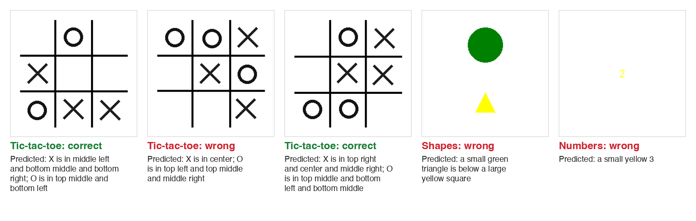

<div align="center">

# Neural Networks to Describe Simple Pictures

**How much does the *shape* of a caption decide what a model can learn? Three image-to-text architectures, three synthetic datasets, and a 32B vision-language model as a reference.**

[](https://ishaan-bhalla-neural-network-to-describe-simple-pict-app-u8tfxe.streamlit.app/)




<sub>The first test image of each dataset, with the MultiHead CNN's prediction (not hand-picked). The middle board is the model's one miss out of 30.</sub>

</div>

## Key results

- **Tic-tac-toe: 96.67% exact captions (29 of 30 test boards)** and 99.26% of individual cells correct, with a 2.5M-parameter CNN that predicts each cell separately.
- **That matches a 32B vision-language model.** Qwen3-VL 32B, run zero-shot on the same 30 boards, also scored 29/30 (98.52% of cells), with about 13,000 times as many parameters.
- **Caption structure decides difficulty.** The same multi-head design reaches only 25% on Shapes and 4% on Numbers, where one wrong attribute out of seven makes the whole caption wrong. On Shapes, a retrieval model (37%) beats it.

## Contents

1. [The question](#1-the-question)
2. [Datasets](#2-datasets)
3. [Models](#3-models)
4. [Results](#4-results)
5. [What we learned and limitations](#5-what-we-learned-and-limitations)
6. [Live demo](#6-live-demo)
7. [Run it](#7-run-it)
8. [Team and my contribution](#8-team-and-my-contribution)

## 1. The question

Image captioning is usually treated as generating a sentence word by word. But many captions follow a fixed template: "X is in the top left", "a small red triangle is left of a blue circle". We compared three ways of producing a caption, each treating it differently:

| Caption treated as | Model | How it produces a caption |
|---|---|---|
| A sentence to retrieve | **Embedding CNN** | Matches the image to the closest caption in a pool |
| A sequence of words | **CNN + LSTM** | Generates the caption one word at a time |
| A set of slots to fill | **MultiHead CNN** | Predicts each attribute separately, then fills a template |

## 2. Datasets

All images are generated with PIL from a fixed random seed, so every result is reproducible. Splits are 80% train, 10% validation and 10% test.

| Dataset | Images | Size | Caption template | Attributes |
|---|---|---|---|---|
| **Tic-tac-toe** | 300 | 256×256 | `X is in [cells]; O is in [cells]` | 9 cells (X, O or empty) |
| **Shapes** | 1,000 | 256×256 | `a [size] [colour] [shape] is [relation] a [size] [colour] [shape]` | 7 |
| **Numbers** | 1,000 | 128×128 | `a [size] [colour] [number]` | 7 (size, colour, length, 4 digits) |

## 3. Models

**Embedding CNN (retrieval).** Image → CNN → 384-dimensional vector, trained to sit close to the caption's Sentence-BERT embedding (`all-MiniLM-L6-v2`). At test time it returns the nearest caption by cosine similarity.

**CNN + LSTM (generation).** Image → CNN encoder → 256-dimensional feature → LSTM decoder. Trained with teacher forcing, decoded greedily.

**MultiHead CNN (structured prediction).** Image → 4-block CNN → 512-dimensional feature → one classification head per attribute (9 for tic-tac-toe, 7 for Shapes and Numbers). The loss is the sum of the heads' cross-entropies, and the caption is rebuilt from the template. It keeps a 4×4 spatial grid (`AdaptiveAvgPool2d(4)`) instead of pooling to a single vector, so the heads can still tell where things are.

## 4. Results

**Exact-caption (sentence) accuracy on the test set**

| Dataset | Embedding CNN | CNN + LSTM | MultiHead CNN |
|---|---|---|---|
| **Tic-tac-toe** (30 test images) | 20% | not recorded (74.5% of words correct) | **96.67%** (29/30) |
| **Shapes** (100) | **37%** | 0% (60.9% of words correct) | 25% (best run, 50 epochs); 7% for the 10-epoch weights in the demo |
| **Numbers** (100) | 5% | not recorded (56.0% of words correct) | 4% |

**Vision-language model reference (tic-tac-toe).** GPT-3.5 can't read images, so we used an open vision model instead. Qwen3-VL 32B ran locally through Ollama, zero-shot, at temperature 0, and was asked for the nine cells as JSON. It ran on the same 30 seeded test boards.

| Model | Exact captions | Cells correct |
|---|---|---|
| MultiHead CNN (ours, 2.5M parameters) | **29/30 (96.67%)** | **99.26%** (268/270) |
| Qwen3-VL 32B, zero-shot | 29/30 (96.67%) | 98.52% (266/270) |

With one miss each on 30 boards, this is a tie, not a win.

**Per-attribute accuracy, MultiHead CNN**

| Tic-tac-toe | | Shapes (best run) | | Numbers | |
|---|---|---|---|---|---|
| 7 of 9 cells | 100% | Object 1 size | 79% | Length | 97% |
| top right, bottom right | 96.7% | Object 1 colour | 65% | Digit 4 | 88% |
| | | Object 1 shape | 64% | Colour | 82% |
| | | **Relation** | **50%** | Digit 3 | 64% |
| | | Object 2 size | 83% | Digit 1 | 60% |
| | | Object 2 colour | 59% | Digit 2 | 51% |
| | | Object 2 shape | 60% | **Size** | **47%** |

## 5. What we learned and limitations

- **When the caption is really a set of slots, predict the slots.** Tic-tac-toe has nine independent cells and no grammar, and the multi-head model is near-perfect there.
- **Exact-match accuracy punishes long templates.** On Shapes, each attribute is right 50-83% of the time, but all seven are right together only 25% of the time. Per-attribute accuracy is the fairer measure there.
- **Relations are the bottleneck.** "Above / below / left of / right of" is 50% on Shapes, against chance of 25%. The model has to compare two objects' positions, which independent heads don't do well.
- **Small test sets.** Tic-tac-toe has 30 test images, so one error moves accuracy by 3.3 points. Treat 96.67% as "29 of 30", not as a precise rate.
- **Synthetic data only.** The models have never seen real photographs and won't generalise to them.
- **The CNN + LSTM wasn't pretrained.** It learns word order well but rarely gets a whole caption right on the larger datasets.

## 6. Live demo

**[Open the demo](https://ishaan-bhalla-neural-network-to-describe-simple-pict-app-u8tfxe.streamlit.app/)**. Pick a dataset, draw a random test image or upload your own, and compare the MultiHead CNN's and CNN + LSTM's captions, with each head's confidence. The app sleeps when nobody has used it for a while; click "Yes, get this app back up" and it starts in about 30 seconds.

## 7. Run it

Tested with Python 3.13.

```bash
git clone https://github.com/ishaan-bhalla/Neural-Network-to-Describe-Simple-Pictures-Group-40.git
cd Neural-Network-to-Describe-Simple-Pictures-Group-40
pip install -r requirements.txt          # demo only
pip install -r requirements-train.txt    # adds what training needs

# Generate the datasets (seeded)
python src/data/generate_shapes.py
python src/data/generate_numbers.py --num_samples 1000
python src/data/generate_tictactoe.py --num-samples 300

# Train (weights go to artifacts/{dataset}/{model}/best_model.pth)
python -m src.training.train_multihead_cnn --dataset tictactoe --epochs 50
python -m src.training.train_cnn_lstm --dataset shapes
python -m src.training.train_embedding_model --dataset-name shapes

# Run the demo
streamlit run app.py
```

**Repository layout:** `src/data/` (generators and dataset classes), `src/models/`, `src/training/`, `src/inference/` (used by the demo), `artifacts/` (trained weights and metrics), `Evaluation/` (evaluation script and results), `app.py` (Streamlit demo).

## 8. Team and my contribution

An MSc group project at the University of Bristol by Group 40: Ishaan Bhalla, [FreyaYZeng](https://github.com/FreyaYZeng), [rmkhan1999](https://github.com/rmkhan1999), [simrithcprince16](https://github.com/simrithcprince16) and [zxxz1203](https://github.com/zxxz1203). The team repository is [rmkhan1999/Neural-Network-to-Describe-Simple-Pictures-Group-40](https://github.com/rmkhan1999/Neural-Network-to-Describe-Simple-Pictures-Group-40); this fork adds the deployed demo and this write-up.

**My contribution (Ishaan Bhalla)**

- **Led model development:** wrote the model and training code for all three architectures and the simple CNN baseline (`src/models/`, `src/training/`).
- **Data loading:** `get_metadata_files`, which loads either one metadata file (Shapes, Numbers) or three split files (tic-tac-toe) through the same interface.
- **Inference and demo:** `src/inference/` and the Streamlit app, which I deployed to Streamlit Community Cloud.
- **Vision-model baseline:** after the project, ran Qwen3-VL 32B on the tic-tac-toe test set to replace a cited GPT-3.5 figure with a measured comparison.
